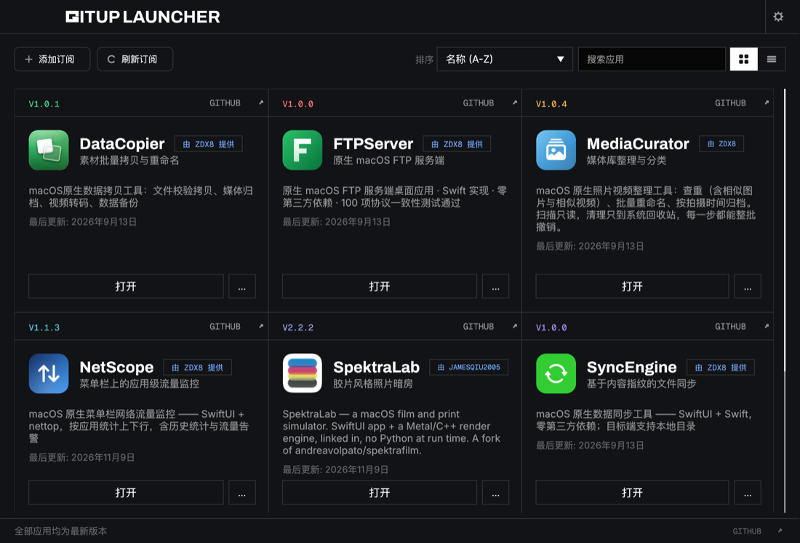

# Gitup Launcher

一个小的 macOS 启动器，用来管理若干 GitHub 仓库发布在 Releases 里的应用。
它会显示哪些已经装好、读取每个仓库的最新发布，并在同一个窗口里完成安装、
更新或打开——不用开浏览器，也不用拖 DMG。



## 安装

到 [Releases](../../releases) 下载 `GitupLauncher-macOS-arm64.dmg`，打开后把
**Gitup Launcher.app** 拖进 `/Applications`。

这个包用的是 ad-hoc 签名，没有 Apple Developer ID，所以首次启动要走 macOS 的
老规矩：右键点应用，选 **打开**；或者自己清掉隔离标记：

```sh
xattr -dr com.apple.quarantine "/Applications/Gitup Launcher.app"
```

需要 macOS 11 或更新版本，Apple 芯片。

## 自己构建

```sh
./bundle.sh
```

它会编译程序，并在同目录刷新 `Gitup Launcher.app`。只需要 Rust 工具链
（1.85 或更新）和 Xcode 命令行工具，没有别的步骤。

## 默认关注的仓库

- zdx8/NetScope-macOS · zdx8/iTelly-macOS · zdx8/MediaCurator-macOS
- zdx8/SyncEngine-macOS · zdx8/DataCopier-macOS · zdx8/FTPServer-macOS
- hety0211/lumen-raw · JamesQiu2005/SpektraLab

更多仓库可以用工具栏的 **添加订阅** 加进来：粘贴一个 `owner/repo` 或完整的
GitHub 链接，或者点 **批量添加** 一次一行地填。订阅也可以在设置页里删掉。

## 功能

窗口跟随系统的浅色／深色设置。布局贴着窗口的实时边缘计算，所以任意尺寸都
正常；卡片多到装不下时，网格是真滚动（滚轮、拖滑块、点轨道都行）。双击顶栏
缩放窗口，拖背景移动窗口。

- **工具栏** —— 左边是 **添加订阅** 和 **刷新订阅**；右边是排序菜单、一个
  输入即过滤的搜索框，以及卡片网格／列表的切换。
- **网格** —— 每个应用一张卡片：图标、名称、发布者、该版本的版本号与日期、
  一句用途说明，以及一个按钮：已装好时显示 **打开**，没装时显示 **安装**，
  有更新时显示 **更新**。尚未安装的应用会放在「未安装」标题下，颜色压暗。
- **卡片菜单** —— GitHub 仓库、更新说明、所有版本、选择版本（可安装任意历史
  版本），然后是卸载软件和删除订阅。
- **单个应用的详情页** —— 发布历史、更新日志，以及用来在其它订阅之间前后
  翻页的箭头。
- **设置** —— 外观、检查更新的时机、安装位置、可选的 GitHub Token，以及带
  × 的订阅列表，用来退订。

版本号、日期和下载链接都由后台线程实时从 GitHub Releases API 取，窗口不会等
网络。已安装的版本读自各应用自己的 Info.plist。安装时会下载该发布的 macOS
资产（优先 arm64，其次 universal；zip 或 dmg），用 ditto 解包或用 hdiutil
挂载，再替换安装目录里的那一份——先把它挪开，中途任何一步失败就放回去。
下载过程中点一下可以取消。

## 自我更新

启动器也从 `zdx8/GitupLauncher-macOS` 读自己的发布。发了新版本后顶栏会提示：
下载在后台跑，新包先落在旧包旁边，等当前进程退出后由一个小的辅助脚本换上去
并重新打开应用。应用还在运行时不会替换任何东西，拷贝失败则回滚到上一个包。

## 请求额度

GitHub API 匿名每小时只给 60 次，刷新几次就没了。填一个 Token 能提到 5000：
在 **设置 → GitHub Token** 里粘贴（只保存在
`~/Library/Application Support/GitupLauncher/settings.json`，仅你的账户可读），
或者在启动前设置 `GITHUB_TOKEN` 环境变量。

## 直接看其它界面

程序可以启动时直接打开某个视图，用来截图很方便：

```sh
./target/release/gitup-launcher --demo list
./target/release/gitup-launcher --demo detail
./target/release/gitup-launcher --demo settings
```

设置 `GITUP_THEME=light`（或 `dark`）可以切到另一套外观，再加
`--screenshot some-file.png` 会把窗口存成图片然后退出。

## 许可证

MIT —— 见 [LICENSE](LICENSE)。内置字体使用 SIL Open Font License，
见 [NOTICE.md](NOTICE.md)。
